# Kut

**Türkçe** · [English](README.en.md)

**Kişisel ilişki ağın, yalnız senin bilgisayarında.** Tanıdığın insanları fotoğraflı bir haritada gör, her görüşmeden sonra tek cümle not düş,
kimi ihmal ettiğini ve bu hafta kime yazman gerektiğini hatırla. Hesap yok, bulut yok; verin düz Markdown dosyaları olarak diskinde durur.

Tanıtım sayfası: **[koraykutlu.github.io/kut](https://koraykutlu.github.io/kut/)** · İndir: [son sürüm](https://github.com/koraykutlu/kut/releases/latest)

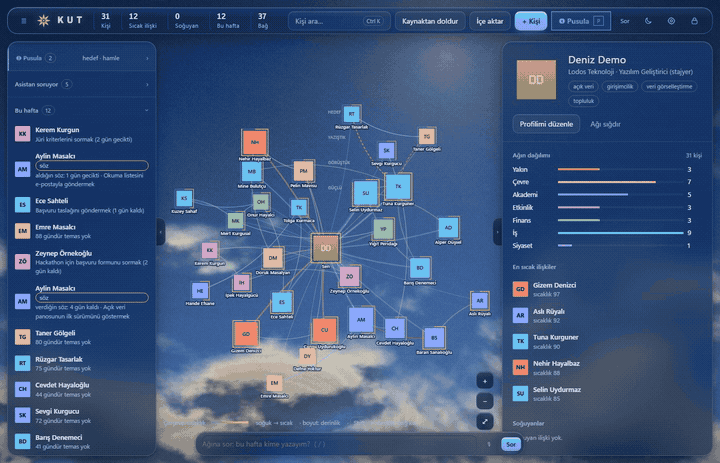

> *Kut (formerly "Ağım") is a local, private personal-network app: a photo map of the people you know, contact log, promises,
> introduction paths and a weekly "who should I reach out to" digest. Python 3 standard library, bound to `127.0.0.1`, no accounts, no cloud,
> plain Markdown data. Interface in Turkish and English (⚙ Settings → *Dil · Language*). **Full English README: [README.en.md](README.en.md).** Licence: MIT.*

Arayüz Türkçe ve İngilizce: varsayılan Türkçe; ⚙ Ayarlar → *Dil · Language* ile değişir. Notların ve kişi dosyaların değişmez.

Bu README'deki tüm ekran görüntüleri ve GIF (v1.1 arayüzü), `demo/demo_veri.py`'nin ürettiği **tamamen kurgusal** verilerle (merkezdeki kişi "Deniz Demo"), içe aktarma örnekleri `demo/ornek/` altındaki kurgusal dosyalarla ve uygulama içi "Deniz'in salısı" demosuyla çekilmiştir; gerçek kişi yoktur.

## İçindekiler
[Neler yapar](#neler-yapar) · [Gizlilik](#gizlilik) · [Kurulum](#kurulum) · [Demo verisiyle deneme](#demo-verisiyle-deneme) ·
[Kullanım ayrıntıları](#kullanım-ayrıntıları) · [Okul bağdaştırıcısı ekleme](#okul-bağdaştırıcısı-ekleme) · [Testler](#testler) · [Lisans](#lisans)

## Neler yapar

### Ağ haritası
Merkezde sen, çevrende tanıdıkların. Renk kişinin türünü (akademi, iş, yakın, çevre, etkinlik, finans, siyaset), halka yakınlığı gösterir;
bağlar arkadaşlık, mentorluk, yöneticilik, iş ortaklığı, akrabalık, rekabet ya da gerginlik gibi tiplerle çizilir.
Sol menüdeki **Dikkat** listesi bağlardan olası çıkar çatışmalarını işaretler (ör. rakip firmadaki bir tanıdık, gergin bir üçgen).
Ağın büyüyünce (48+ kişi) harita kendini düzenler: yakınlık eş merkezli halkalar (güçlü içte), tür açısal dilimler ("Akademi · 42"), yerler her açılışta aynıdır; adlar yakınlaştıkça belirir ve çakışmaz,
kişi–kişi bağları soluktur ve bir kişinin üstüne gelince ya da onu seçince onun komşulukları öne çıkar. Sürüklediğin kişi yerinde kalır; ↺ düğmesi hepsini yerine döndürür. Dilime tıklayınca oraya yaklaşır.
Az kişili ağda (47'ye kadar) eski sıcak, kuvvet tabanlı görünüm sürer. Kalabalık ağı denemek için `py -3 demo/kalabalik_veri.py --kisi 400 --hedef KLASÖR` (kurgusal adlar).

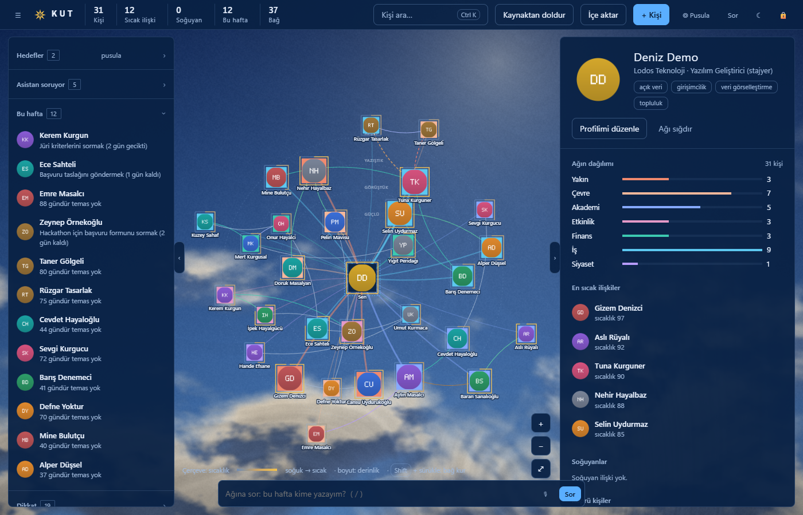

### Kişi kartı ve temas ritmi
Her kişi bir Markdown dosyasıdır: kurum, rol, "neden önemli", "ne verebilirim", sonraki adım ve tarihi. Görüşme sonrası tek cümlelik
**temas** eklenir; son temas, görüşme sıklığı beyanın ve yakınlığa göre ihmal eşiği (yakınlık 3: 14 gün, 2: 30, 1: 60) hesaplanır.
Altı ilişki puanı (sıcaklık, derinlik, karşılıklılık, süreklilik, köprü, ortak zemin) ve isteğe bağlı özellik puanları (uzmanlık, destek, güvenilirlik...)
kayıtlardan hesaplanır, "Puanlar neye göre?" bölümünde ölçütleri görünür.

| Profil ve özellikler | Temaslar ve zaman çizelgesi |
|---|---|
| 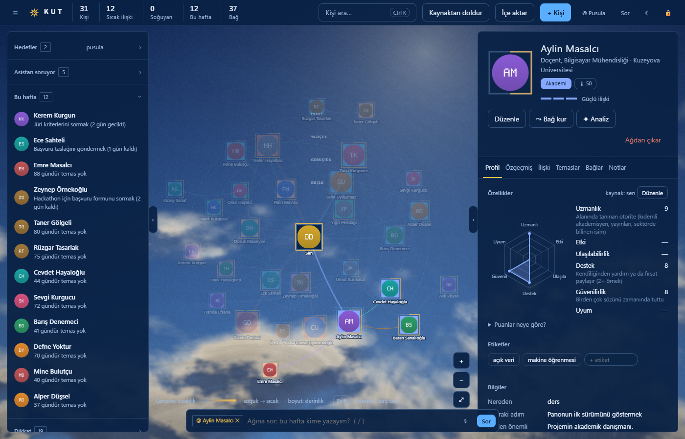 | 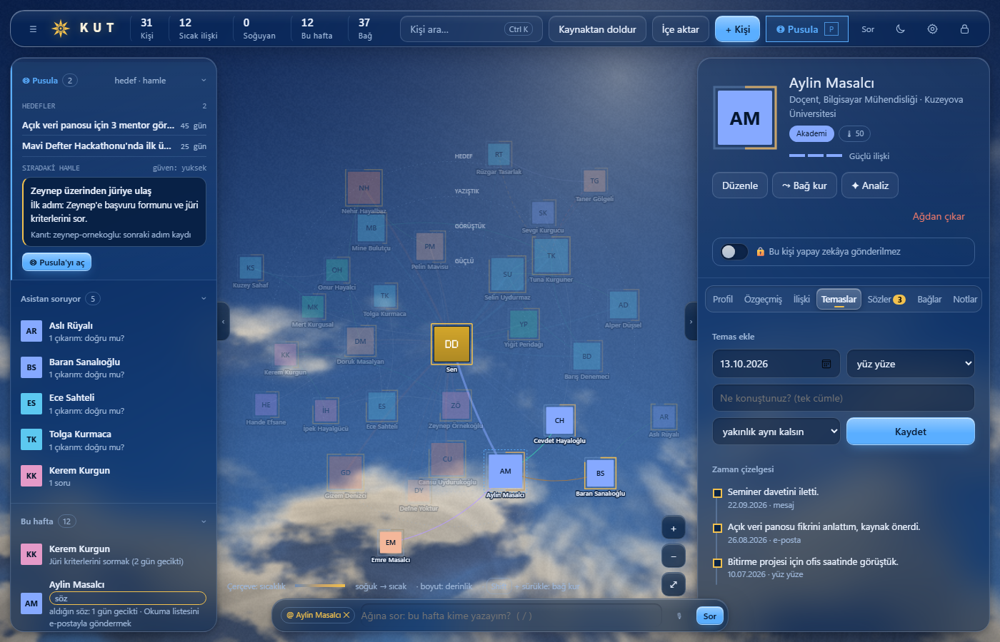 |

### Sözler
Bir kişiye verdiğin ya da ondan aldığın söz ("Ayşe'ye kitabı göndereceğim", "Mehmet bana staj ilanını yollayacak") kişi kartındaki **Sözler** sekmesinde tutulur:
yön, metin, isteğe bağlı son tarih; *Tamamla* ya da *İptal*. Kaynak, kişi dosyasındaki `## Sözler` bölümüdür:
`- [ ] 2026-10-13 · ben → o · kitabı göndermek (son: 2026-10-17)` (`ben → o` = sen verdin, `o → ben` = o verdi; tamamlanan `[x]` ve `(tamam: GGG)`, iptal `[-]` ve `(iptal: GGG)`;
iptal satırı silinmez, yazımdan önce `arsiv/surum/`'a kopya alınır). Gecikmiş ya da son tarihi 7 gün içinde olan sözler **Bu hafta** listesinde "söz" etiketiyle ve
"verdiğin söz: 2 gün gecikti" gibi görünür; Pusula hamleleriyle karışmaz.

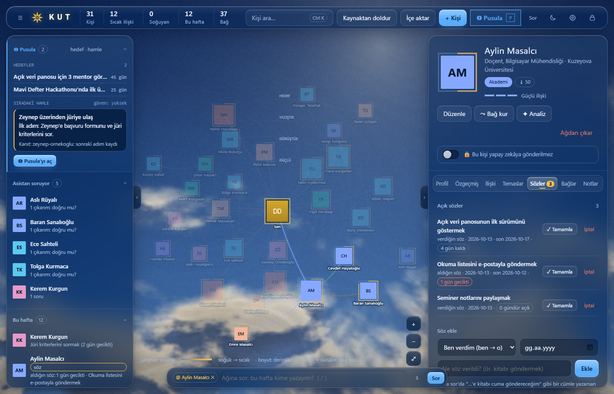

**Kut'a sor**'da "Ayşe'ye kitabı cuma göndereceğim" yazarsan Kut kişiyi, yönü, metni ve tarihi (yarın, cuma, haftaya, ay sonu, 3 gün sonra, 17 Ekim...) yerelde ayrıştırır ve
**"Ayşe'ye söz olarak ekleyeyim mi? (son: 16.10)"** diye sorar; sen onaylamadan hiçbir şey yazılmaz. Soru, olumsuz, geçmiş ve koşullu cümleler (ve belirsiz ad) öneri üretmez. Sözler kişi dosyasının parçasıdır,
yani uzak modele yalnız kapıdan geçerek gider; kişi **🔒 Bu kişi yapay zekâya gönderilmez** ise hiç gitmez.

### Bu hafta
Tarihi gelen sonraki adımlar, ihmal edilenler ve gecikmiş/yaklaşan sözler tek listede; bir tıkla haritada yalnız onlar öne çıkar. Hariç listesindeki kişiler hiçbir öneriye girmez.

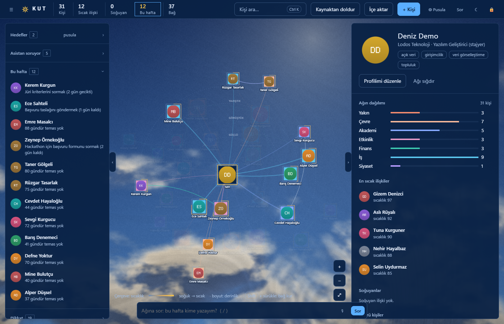

### Nasıl ulaşırım? Tanıştırma yolu
Birine ulaşmak istediğinde (bir hoca, bir şirketteki biri, bir alandaki herhangi biri) kişi kartındaki **↗ Nasıl ulaşırım?** düğmesi ağındaki en sıcak yolu bulur: kim kimi tanıyor, ilk adımı kim atar, ne yazacaksın.
Sağ panelde zincir (Sen → Baran → Selin Hoca), her bağın gücü, gerekçe ("Baran ile yakınsın; son temas 3 gün önce"), dikkat edilecekler ("Baran ile 90 gündür konuşmadın; tanıştırma istemeden önce bağı ısıt") ve kopyalanabilir bir mesaj taslağı görünür; haritada yol öne çıkar, kalanı soluklaşır.
*Amaç* alanı taslağı yeniden yazar, *Bu adımı takip et* öneriyi **Pusula → Sonuçlar**'a kaydeder. Kişi adı yerine kurum ya da alanla da arayabilirsin (**Pusula → Ulaş**: «Şişecam», «finans»). Hesap tamamen yereldir; hariç listendeki kişiler yola hiç girmez.

### Görüşme brifingi
Birini aramadan ya da buluşmadan önce kartındaki **Brifing** tek sayfa hazırlar: seninle ilişkisi, son konuşmalar, açık sözlerin (gecikmiş olan başta), sonraki adım, ortak tanıdıklar, görüşmede açabileceğin konular ve Kut'un bu kişi için daha önce önerdikleri. Markdown olarak kopyalanır ya da yalnız brifing yazdırılır.

### Kut sana gelir: haftalık özet ve "Nasıl geçti?"
Kut her hafta ilk açıldığında, söyleyecek bir şeyi varsa, bir özet gösterir: bu hafta ilgilenmen gereken en çok üç kişi (neden, tek somut adım, yazmaya hazır taslak) ve söz verdiklerin. *Yaptım / Ertele / Atla* der, birkaç gün sonra *işe yaradı mı?* diye sorar; kararına göre öneriler ayarlanır (iki kez atladığın kişiyi dört hafta rahat bırakır, iki kez işe yaramayan yolun yerine başka bir yol ister). *Temas olarak kaydet* kutusu kişinin temas geçmişine satır ekler.
Özete sol paneldeki **Bu hafta → Haftanın özeti**'nden her zaman dönebilirsin. Kayıtlar `veri/sonuclar.md` (okunur tablo, elle de düzenlenir) ve `veri/ozet/` altındadır; son 8 haftanın sayıları Pusula → Sonuçlar'da.

### Kut kapalıyken de haber verir (isteğe bağlı)
⚙ Ayarlar → **Kut sana gelsin** açılırsa bilgisayarında zamanlanmış bir görev kurulur (Windows Görev Zamanlayıcı, macOS launchd, Linux systemd) ve haftada bir (ya da her sabah, yalnız o gün bir şey varsa) sistem bildirimi gösterir. **Varsayılan kapalıdır**, kapatınca görev kaldırılır. Bildirim yalnız sayı taşır («Bu hafta 3 kişi ve 1 söz seni bekliyor»); adlar için ayrı bir anahtar vardır ve uyarısı okunmalıdır: adlar kilit ekranında ve bildirim merkezinde görünebilir, Kut'un PIN kilidini aşar. Not, söz ya da taslak metni bildirime hiç girmez. Bu özellikler ağa çıkmaz.

### Çıkarım onay kuyruğu ("Asistan soruyor")
Asistanın (yapay zekâ) kişiler hakkındaki çıkarımları (ilişki özeti, etiket, puan, bağ, kurum/rol, sorular) **sen onaylamadıkça kişi dosyasına yazılmaz**.
Her biri için *Doğru / Düzelt / Yanlış* dersin; reddedilen çıkarım tekrar önerilmez. Senin doğrudan söylediğin (görüş, görüşme sıklığı)
çıkarımdan önce gelir ve onu ezmez. Kural motoru (`ag_tutarlilik.py`, model yok) bağlamla çelişen önerileri silmeden kapatır.

### Pusula: hedefler, keşif, strateji
Hedeflerini (başlık, tür, son tarih, öncelik, başarı ölçütü, konu kelimeleri) yazarsın; ilerleme satırı eklenir, tamamlanır, arşivlenir.
*Keşfet* sekmeleri herkese açık kaynakları (TBMM vekil faaliyetleri, schema.org etkinlik sayfaları) hedeflerinin konu kelimeleriyle eşleştirir;
"Ağa ekle" demeden kimse ağına girmez. Vekil verisi (Vekilpedia) ve etkinlik taraması yeni kurulumda **kapalıdır**; ⚙ Ayarlar → *Kaynaklar*'dan açılır (ya da `ayarlar.json` → `kesif.vekilpedia` / `kesif.etkinlik: true`). Eski kurulumlar, daha önce veri indirdiyse, özelliği kaybetmesin diye açık kalır. *Stratejik okuma* hedefleri ve ağını bir modele okutup kanıtlı, hedefe bağlı "görmediğin hamleler" üretir.

| Hamleler | Hedefler |
|---|---|
| 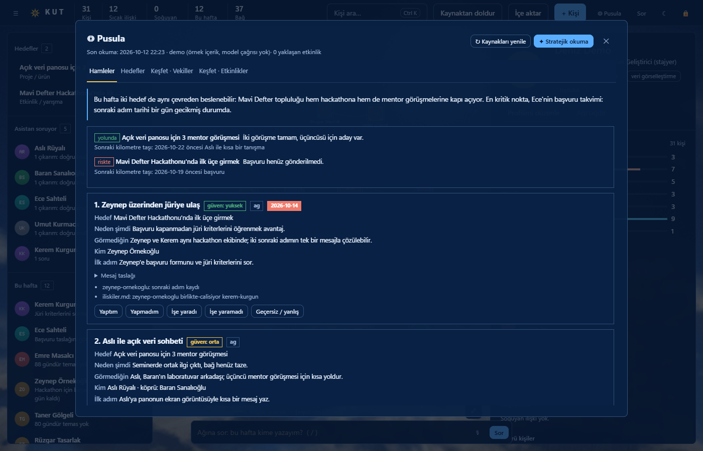 | 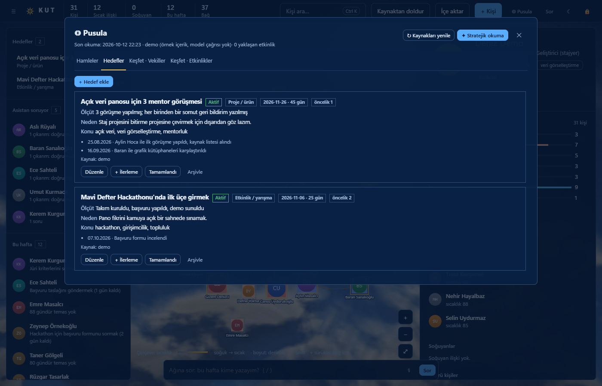 |

> Ekran görüntülerindeki "Stratejik okuma" içeriği demo veri üreticisinin yazdığı örnek metindir; model çağrılmamıştır.

Pusula her zaman göz önündedir: üst çubukta vurgulu **◎ Pusula** düğmesi (kısayol **P**) ve sol panelin en üstünde bir **Pusula kartı** durur. Kart aktif hedeflerini, bu haftanın sıradaki hamlesini (strateji okumasından ilk hamle, ilk adımı ve ilk kanıtıyla) ve tek tıkla Pusula'yı açan düğmeyi gösterir. Hedefin yoksa *İlk hedefini yaz*, strateji henüz çıkarılmadıysa *Bu haftanın stratejisini çıkar* der; ikincisi seçili yapay zekâ sağlayıcısına gittiği için başlatmadan önce onay ister (sağlayıcı seçimi, kişi kapısı ve sır süzgeci aynen geçerli). Pusula penceresi yalnız *Hamleler, Hedefler, Keşfet · Vekiller, Keşfet · Etkinlikler* sekmelerini taşır; kaynak, okul, güncelleme, ses ve kasa kartları ⚙ **Ayarlar** penceresindedir.

### İlk açılış: kurulum ve tanıtım
İlk PIN belirlendikten sonra Kut bir kez bir sihirbaz açar; önce kurulumu yapar, sonra özellikleri tanıtır. Hoş geldin adımı seni profilindeki ilk adla karşılar ve günün saatine göre kısa bir cümle seçer; *Önce bir örnekle göster* düğmesi kurgusal bir ağı oynatır ([Demo verisiyle deneme](#demo-verisiyle-deneme)). Kurulum adımlarının her biri atlanabilir, zaten bilinenler (kayıtlı ad ve fotoğraf, seçili sağlayıcı, kurulu ses, alınmış kasa kişileri, okul ve dersler) otomatik atlanır; *Hazır olanları da gez* hepsini gösterir: (1) adın ve kim olduğun (Profilim alanları), (2) yapay zekâ sağlayıcısı (Claude Code önerilir; Codex/Gemini seçilirse gizlilik uyarısı ve onay istenir, kurulu olmayanlar soluk), (3) sesli iletişim (mevcut Whisper + EMA Lightning kurulum sorusu; *Şimdi değil* seçilebilir), (4) kasa bağlıysa *Kasadan kişileri al* (kasa yoksa bu adım görünmez), (5) okul ve dersler ile İçe aktar penceresine yönlendirme. Ardından **sahne ışığı turu** başlar: tanıtılan öğe kendi renginde ve tam parlak kalır, gerisi koyu bir örtüyle gölgelenir; yanındaki kartta başlık, kısa açıklama, *Geri / İleri / Turu bitir* ve adım sayacı vardır (klavye: ← → Esc; `prefers-reduced-motion` açıksa geçişler kapanır). Sıra: ağ haritası, kişi kartı, Sözler, "Bu kişi yapay zekâya gönderilmez" anahtarı, Doğrula ("Asistan soruyor"), Bu hafta, Kut'a sor ve sesli giriş, Pusula, İçe aktar, Ayarlar, Kilit. Hedef ekranda yoksa (boş ağ, dar pencere) adım sessizce atlanır; kapalı bir panel tur için açılır ve sonra eski haline döner. Tamamlanma ayarlarda tutulur (`ayarlar.json` → `sihirbaz.bitti`; yazan uç `/api/sihirbaz`: kilit + anahtar + yerel Origin). Sihirbazı kapatmak da "bitti" sayılır; ⚙ Ayarlar → *Kurulum ve tanıtımı aç* (ya da *Yalnız özellik turu*) ile istediğin zaman yeniden açarsın. Yeni tur adımı eklemek `kut/ag_sablon.html` içindeki `TUR_ADIMLARI` dizisine bir satır eklemektir (`id`, hedef seçici `hedef`, `baslik`, `metin`).

| Hoş geldin adımı | Yapay zekâ sağlayıcısı adımı |
|---|---|
| 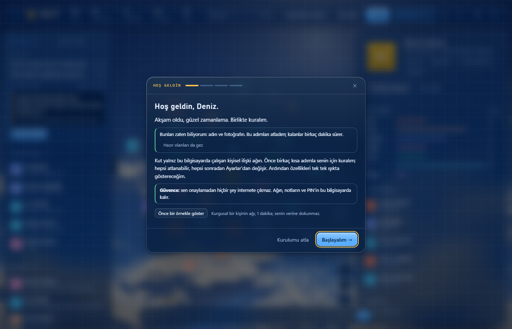 | 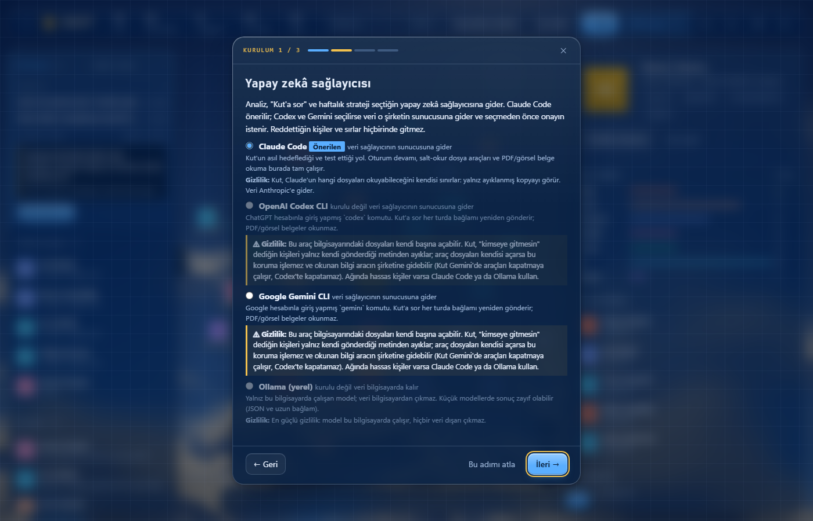 |

### Diğer özellikler
- **İçe aktarma (WhatsApp, rehber, takvim, LinkedIn, ders listesi):** WhatsApp sohbetini (.txt/.zip, "medya olmadan"), .vcf rehberi, takvim dışa aktarmasını (.ics), LinkedIn veri kopyasını (Connections.csv / messages.csv) ya da okulundan kopyaladığın ders listesini *İçe aktar* penceresine bırakırsın; önce ne olacağını görürsün (önizleme hiçbir şey yazmaz), sonra onaylarsın. Mesaj içerikleri, toplantı açıklaması ve konumu saklanmaz; yalnız kim, ne zaman, hangi kanal. Ayrıntı: [Kullanım](#kullanım-ayrıntıları).
- **Okul bağdaştırıcısı:** profilindeki okul ve derslerden hocaları, ders saatlerini ve kadro sayfasından unvan/e-posta/özgeçmişi (kaynağıyla, yalnız boş alanlara) doldurur. Okul tanımlı değilse kapalıdır; [desteklenen okullar](#desteklenen-okullar) arasından seçilir, okulun yoksa bağdaştırıcı eklenebilir ([aşağıda](#okul-bağdaştırıcısı-ekleme)). Profilim'e "bu dönem ISE 424, ISE 426 ve MATH 101 alıyorum" yazman yeter: dersler profiline kaydolur. Kut'a sor'da aynı cümle önce yazılmaz; sorunu cevaplar ve "ISE 424, ISE 426 ve MATH 101’i bu dönemki derslerine ekleyeyim mi?" diye sohbette onay düğmesi gösterir (soru, olumsuz ve geçmiş cümleler, ay/gün adları ve para tutarları ders sayılmaz). Onaydan sonra okul seçiliyse hocalar kendiliğinden eklenir (okul seçili değilse önce hangi okulda olduğunu sorar). Okul kaynağından eklenen hocalar yakınlık 0 ile başlar; yakınlığı yalnız sen artırırsın.
- **Kut'a sor (`/`):** "Ayşe hocayla bugün konuştum, başvurum onaylanmış, Berk'le artık haftada bir görüşüyoruz" gibi serbest metni temas, beyan, sonraki adım ve bağlara ayırıp kaydeder; her yazımdan önce kişinin eski hali `veri/arsiv/surum/`'e kopyalanır.
- **PIN kilidi:** açılışta PIN sorulur; kilitliyken sunucu hiçbir kişisel veri göndermez (görsel örtü değil, sunucu tarafında).
- **İkinci beyin köprüsü (isteğe bağlı, salt okur):** bir not kasasındaki açık işleri ve kişinin geçtiği satırları gösterir; kasaya hiçbir şey yazmaz.
- **Yerel ses (isteğe bağlı):** Whisper ile konuşmayı yazıya çevirir, EMA Lightning ile cevapları Türkçe okur; hepsi bu bilgisayarda çalışır, ses diske yazılmaz. Kurulu değilse Kut, onayınla indirmeyi teklif eder (boyutlar önceden gösterilir).
- **Yapay zekâ sağlayıcısı:** Claude Code (önerilen), Codex CLI, Gemini CLI ya da yerel Ollama; sihirbazdan ya da Profilim → *Yapay zekâ sağlayıcısı*'ndan seçilir. Kut API anahtarı istemez ve saklamaz; ayrıntı ve sınırlar [Gizlilik](#gizlilik)'te.
- **Görünüm:** bu bilgisayarda çizilen WebGL gökyüzü, gündüz/gece teması; pencere ve sekme geçişlerinde kısa arayüz sesleri (⚙ Ayarlar → *Arayüz sesleri*, varsayılan açık, kapatılabilir).

İçe aktarma önizlemeleri (kurgusal `demo/ornek/takvim.ics` ve `demo/ornek/linkedin-Connections.csv` ile; önizleme hiçbir şey yazmaz):

| Takvim (.ics) | LinkedIn (Connections.csv) |
|---|---|
| 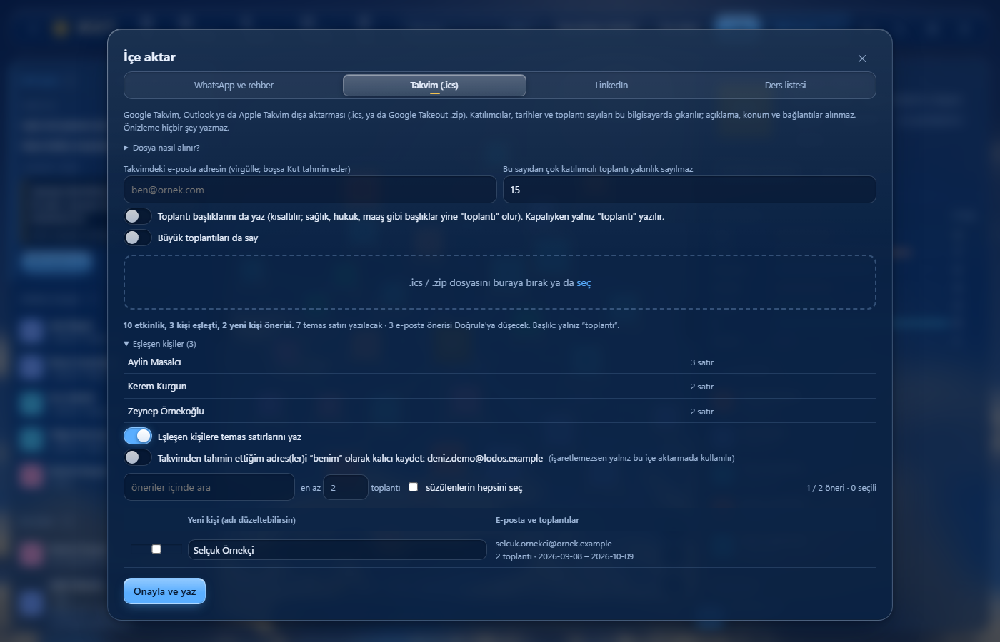 | 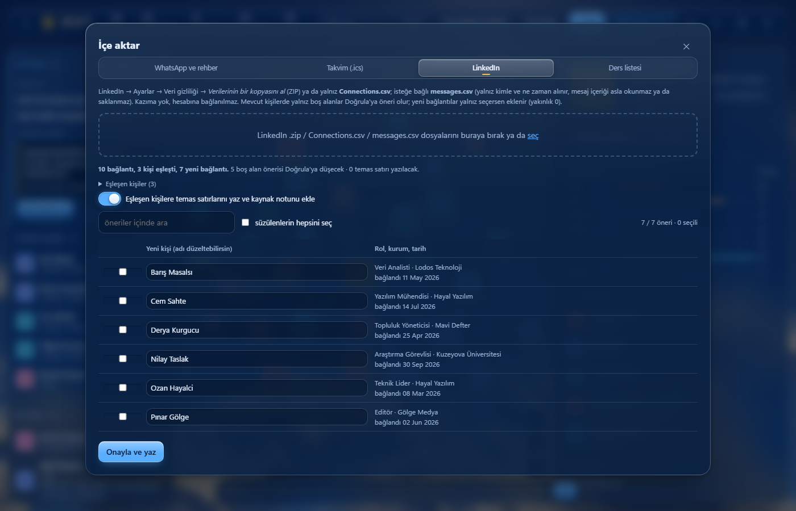 |

Üst çubuktaki ⚙ **Ayarlar** penceresi kurulum ve tanıtımı, arayüz seslerini, isteğe bağlı dış kaynakları, okul bağdaştırıcısını, güncellemeyi ve sesli iletişimi (kasa bağlıysa kasa kartını da) tek yerde toplar:

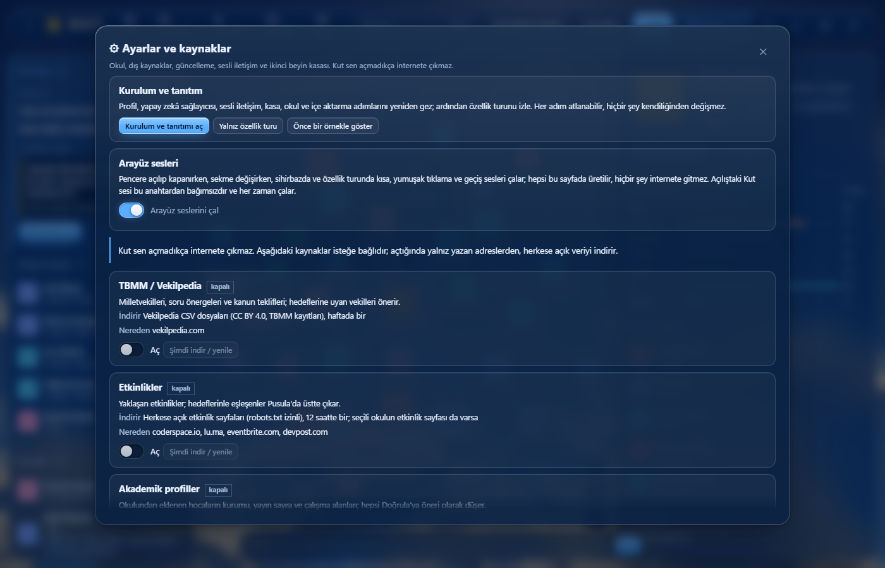

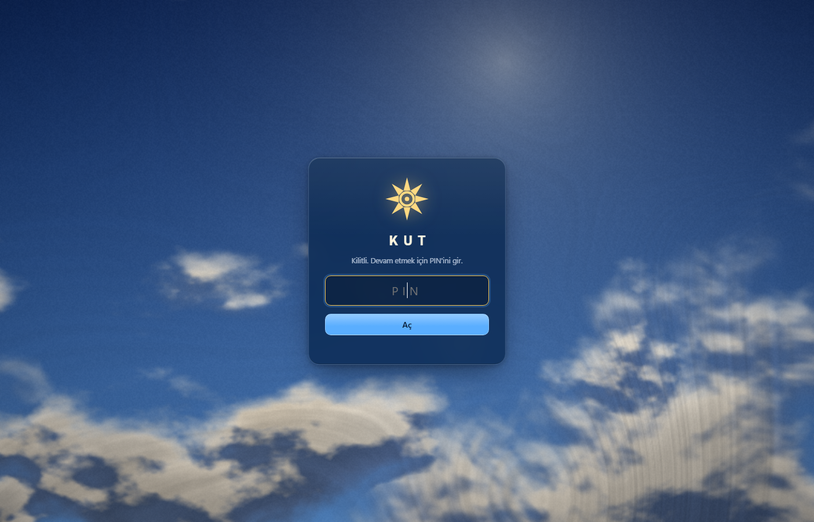

## Gizlilik

**İlke: Kut yalnız senin bilgisayarında çalışır.** Bulut, hesap, senkronizasyon, mobil uygulama, telemetri yok. Sunucu yalnız `127.0.0.1`'de dinler
(dışarıdan erişilemez; Host/Origin denetimi yapılır) ve sayfa kapandıktan ~20 dk sonra kendiliğinden durur.
Verin `veri/` klasöründe düz Markdown olarak durur ve `.gitignore` ile depodan dışlanmıştır; içe aktarma adayları `%LOCALAPPDATA%\agim` (macOS/Linux `~/.agim`) altında bekler.

**Kut sen açmadıkça internete çıkmaz.** Yeni kurulumda hiçbir dış kaynak açık değildir. Üst çubuktaki ⚙ **Ayarlar** penceresi (Kaynaklar kartları), açabileceğin isteğe bağlı kaynakları, neyi nereden indirdiklerini ve açma/kapama düğmelerini tek yerde gösterir (Pusula yalnız hedef, keşif ve stratejiyi taşır):

| Kaynak | Ne indirir | Nereden | Varsayılan |
|---|---|---|---|
| TBMM / Vekilpedia | milletvekilleri, soru önergeleri, kanun teklifleri (CSV, CC BY 4.0), haftada bir | vekilpedia.com | kapalı |
| Etkinlikler | yaklaşan etkinlik sayfaları (robots.txt izinli), 12 saatte bir | coderspace.io, lu.ma, eventbrite.com, devpost.com (+ seçili okulun etkinlik sayfası) | kapalı |
| Okul bağdaştırıcısı | ders programı, akademik kadro sayfası (yalnız profilinde okul ve ders kodu varsa) | seçtiğin okulun herkese açık sitesi ([tablo](#desteklenen-okullar)); istekler arası en az 0,5 sn | yok |
| Akademik profiller | okulundan eklenen hocaların kurumu, yayın sayısı, çalışma alanları (yalnız hocanın adı sorulur; sonuç Doğrula'ya öneri olarak düşer) | api.openalex.org, pub.orcid.org | kapalı |

**Ağa çıkabilen yollar.** Kut'un ağa çıkabilen tüm yolları şunlardır; her biri varsayılan olarak kapalıdır ya da senin açık onayına bağlıdır, listede olmayan hiçbir yol yoktur:

| Yol | Nereye | Ne zaman |
|---|---|---|
| Güncelleme denetimi | api.github.com (yalnız GET, veri gönderilmez) | otomatik denetim ilk soruya *Evet* dersen haftada bir; düğme elle |
| Ses kurulumu | PyPI (paketler), Hugging Face (modeller) | yalnız kurulum teklifine *Evet* dersen (`onay: true`); sonra çevrimdışı |
| Okul siteleri | seçtiğin okulun herkese açık sitesi | okul seçili ve profilinde ders varsa, sen "Kaynaktan doldur" deyince |
| OpenAlex / ORCID | api.openalex.org, pub.orcid.org (yalnız hocanın adı) | `kesif.akademik` açıksa (yeni kurulumda kapalı) |
| Vekilpedia | vekilpedia.com | `kesif.vekilpedia` açıksa (yeni kurulumda kapalı) |
| Etkinlikler | tablodaki etkinlik siteleri | `kesif.etkinlik` açıksa (yeni kurulumda kapalı) |
| MCP istemcisi | bağladığın asistanın modeli (ör. Anthropic) | yalnız Kut'u bir MCP istemcisine sen eklersen ve asistan aracı çağırınca; kişi kapısından geçer, salt okur |
| Uzak model sağlayıcıları | Anthropic (Claude Code), OpenAI (Codex), Google (Gemini); yerel Ollama hiçbir yere çıkmaz | yalnız sen analiz / "Kut'a sor" / strateji kullanınca; Codex ve Gemini seçilirken ayrıca onay istenir |

**Ağa çıkmayanlar.** İçe aktarmalar (WhatsApp, rehber, takvim .ics, LinkedIn CSV/ZIP, yapıştırılan ders listesi) tamamen yerelde, bu bilgisayarda işlenir; yukarıdaki listede yoktur, çünkü hiçbir istek yapmazlar (takvim ve LinkedIn için hesabına bağlanma, gizli takvim adresi ya da kazıma yoktur). Kaynak dosyadaki talimatlar veridir, komut değildir. **Uygulamaya girmeyen geliştirici aracı:** `paketleme/demo_seslendir.py`, demo anlatım seslerini yayın öncesi bir kez Google Gemini TTS ile üretir (anahtar yalnız `GEMINI_API_KEY` ortam değişkeninden okunur, yalnız sabit demo metinleri gider, kişi verisi gitmez); `Kut.exe`'ye ve çalışan uygulamaya dahil değildir, Kut onu hiçbir zaman çalıştırmaz. Hazır ses dosyaları (`kut/demo_ses/`) uygulamayla yalnız çalınmak üzere gelir.

Ayrıntılar ve sınırları:

1. **Herkese açık sayfalar** (yukarıdaki tablo). Yalnız herkese açık, girişsiz sayfaları indirir; ağındaki hiçbir bilgi bu isteklerle gönderilmez. Önceden veri indirmiş eski kurulumlarda Vekilpedia ve Etkinlikler açık sayılır; Kaynaklar sekmesinden kapatılır.
2. **İsteğe bağlı yapay zekâ asistanı.** Analiz, "Kut'a sor" ve stratejik okuma, bilgisayarında kurulu bir yapay zekâ komut satırı aracı üzerinden bir modele gider (varsayılan ve önerilen: **Claude Code**, `claude -p`; alternatifler aşağıda).
   Seçili sağlayıcı (Claude Code, Codex CLI, Gemini CLI ya da yerel Ollama) kurulu ya da çalışır değilse bu özellikler çalışmaz (düğmeler seçili sağlayıcının adıyla Türkçe bir uyarı gösterir), geri kalan her şey çalışır. Bunlar yalnız sen kullanınca çalışır; tek istisna: seçili sağlayıcı hazırsa ve **onayladığın (aktif) bir hedefin** varsa, son stratejik okumadan 7 gün geçince Kut açılışta okumayı kendiliğinden başlatır. Kapatmak için `ayarlar.json` → `"otomatik_strateji": false`. Modele giden her kişi verisi önce yerel **kapıdan** (`ag_kapi.py`) geçer:
   - `remote_allowed: false` olan kişi (ya da dosyası okunamayan) ne istemde ne de modele hazırlanan geçici veri kopyasında bulunur. Kişi kartındaki **🔒 Bu kişi yapay zekâya gönderilmez** anahtarı bu alanı yazar/kaldırır (yazımdan önce sürüm kopyası alınır, bellekteki sohbet geçmişi hemen silinir); açıkken kartta rozet görünür, "✦ Analiz" ve belge özetleme o kişi için kapanır (belge yalnız yerelde saklanır);
   - `veri/haric.md` ile eşleşen kurum/parti kişileri aynı şekilde dışarıda kalır; kopyada ayrıca `haric.md`, `ag.html`, `arsiv/`, kilit ve ayar dosyaları yoktur;
   - **sır filtresi** (`ag_sir.py`) anahtar, token, parola gibi değerleri (kodlanmış halleriyle) `[gizlendi]` yapar;
   - **Claude Code'da** araçları Kut kısıtlar: dosya araçları yalnız süzülmüş geçici kopyada salt-okurdur, yazma, kabuk ve web araçları kapalıdır; kopya çıkışta silinir. **Codex ve Gemini'de bu garanti yoktur:** bkz. aşağıdaki *Araçlı sağlayıcıların sınırı*.
   - Oturumsuz sağlayıcılarda (Codex, Gemini, Ollama) bellekteki sohbet geçmişi her turda bu kapıdan ve sır süzgecinden yeniden geçer; kilitlenince, sağlayıcı değişince ya da kapı listesi (`haric.md`, `remote_allowed`) değişince silinir.
   Claude modelleri `ayarlar.json` içinden değiştirilebilir (`analiz_modeli`, `sohbet_modeli`, `strateji_modeli`).

   **Hangi yapay zekâ?** Kut tek bir sağlayıcıya bağlı değil; dönemin en iyi seçeneği değişir. Profilim → *Yapay zekâ sağlayıcısı* (ya da `ayarlar.json` → `"saglayici"`) ile seçersin.
   Hepsi bilgisayarında kurulu, kendi girişini yöneten komut satırı araçlarıdır; **Kut API anahtarı istemez ve saklamaz**. Claude Code önerilir (Kut onunla geliştirildi ve test edildi).

   | Sağlayıcı (`saglayici`) | Komut | Veri nereye gider | Notlar |
   |---|---|---|---|
   | `claude` (varsayılan, **önerilen**) | `claude -p` | Anthropic | Oturum devamı, salt-okur dosya araçları, PDF/görsel belge okuma tam çalışır |
   | `codex` | `codex exec` | OpenAI | `--sandbox read-only` yazmayı engeller, **okumayı engellemez**; boş geçici klasörde çalışır; seçerken onay ister; "Kut'a sor" her turda bağlamı yeniden gönderir; PDF/görsel belge okumaz |
   | `gemini` | `gemini -p` | Google | `plan` kipi + "tüm araçlar yasak" politikası, boş geçici klasör; seçerken onay ister; "Kut'a sor" her turda bağlamı yeniden gönderir; PDF/görsel belge okumaz |
   | `ollama` | yerel HTTP `127.0.0.1:11434` | **bilgisayardan çıkmaz** | Küçük modellerde sonuç zayıf olabilir; veri bütçesi kısıtlıdır |

   Claude dışındaki sağlayıcılara Kut dosya aracı vermez; strateji ve "Kut'a sor" için kapıdan geçmiş veri kopyasının metni istemin içinde gider. Hiçbir sağlayıcıya yazma izni verilmez.

   **Araçlı sağlayıcıların sınırı (Codex, Gemini): kapı yalnız Kut'un gönderdiği veriyi süzer.**
   - Codex'te `--sandbox read-only` yazmayı engeller ama okumayı engellemez: model kabuk komutuyla bütün diski, gerçek kişi klasörünü ve `haric.md`'deki kişileri okuyabilir. Codex'in kabuğu ya da araçları kapatan `-c` anahtarları resmi belgeden (github.com/openai/codex) doğrulanamadı ve Codex bu makinede kurulu olmadığı için denenemedi; bu yüzden uydurma bayrak kullanılmaz.
   - Gemini'de `--approval-mode plan` salt-okur araçları (dosya okuma, arama, web) açık bırakır. Kut ek olarak `--admin-policy` ile `*` için `deny` kuralı verir (Gemini CLI 0.62 belgesine göre genel deny araçları modelin görüşünden de çıkarır), `GEMINI_CLI_SYSTEM_SETTINGS_PATH` ile `tools.exclude` yedeği koyar ve istemdeki `@yol` ifadelerini (Gemini'nin kendi okuyup eklediği) kaçışlar. Bu yapılandırma kaynak kod ve belgeden doğrulandı; ancak bu makinedeki Gemini hesabı oturum açamadığı için (IneligibleTierError) canlı bir model çağrısında denenemedi.
   - İkisi de boş, geçici bir klasörde çalışır, ama bu bir sınır değil önlemdir: belgeye gömülü bir talimat kapı dışı veriyi okuyup uzağa gönderebilir. Bu yüzden **Codex ya da Gemini seçilirken açık onay istenir** ("Bu araçlar kendi araçlarıyla diskteki dosyaları okuyabilir; Kut'un kişi kapısı yalnız Kut'un gönderdiği veriyi süzer. Hassas ağlar için Claude Code (araçları Kut kısıtlar) ya da yerel Ollama öner."); onaysız seçim reddedilir (`POST /api/saglayici` → `onay: true`).
   Kapı (`ag_kapi.py`) ve sır süzgeci (`ag_sir.py`) hangi sağlayıcı seçili olursa olsun aynen çalışır; Ollama dışındakiler "uzak" sayılır. Kurulu olmayan sağlayıcı seçilemez.
   Claude dışı sağlayıcılarda model adı `ayarlar.json` → `"modeller": {"codex": "...", "gemini": "...", "ollama": "..."}`; boşsa aracın kendi varsayılanı (Ollama'da yüklü ilk model) kullanılır.
3. **Sürüm denetimi (GitHub).** Yalnız `api.github.com/repos/koraykutlu/kut/releases/latest` adresine, sürüm bilgisini almak için bir GET gider; hiçbir veri gönderilmez. Otomatik denetim, ilk açılışta sorulan soruya **Evet** dersen haftada bir yapılır (`ayarlar.json` → `guncelleme.otomatik`; sormadan ve Hayır dersen asla). Ayarlar → Kaynaklar → *Güncelleme var mı?* düğmesi elle her zaman çalışır.
4. **Sesli iletişim kurulumu (Whisper + EMA Lightning).** 🎙 ya da 🔈'a ilk dokunduğunda (ya da Ayarlar → Kaynaklar → *Sesli iletişim*) Kut sorar; **Evet** demeden hiçbir şey inmez. Evet dersen yalnız PyPI (sabit sürümlü paketler) ve Hugging Face (model dosyaları) adreslerine gidilir; ses, metin ve kişi verin gönderilmez. Kurulum bittikten sonra ses işçileri çevrimdışı çalışır. Ayrıntı: aşağıda *Ses*.
   **Kurulumun güvenliği ve sınırı:** `pip` yalıtılmış çalışır (`python -I`, `pip --isolated`; ortamdaki `PIP_INDEX_URL`, `PIP_EXTRA_INDEX_URL`, `PIP_TRUSTED_HOST` ve `pip.ini` yok sayılır, `HF_ENDPOINT` aktarılmaz). `ema-lightning 1.1.2` ve `normalizer-tr 0.7.0` **`--require-hashes`** ile sha256'ya sabitlenir (değerler PyPI JSON API'sinden alındı). Bu iki paket 10-11 Ekim 2026'da yayımlanmış, yani **çok yenidir**; yayıncılarına güvenmeyi kabul edersin. `torch`, `faster-whisper`, `ctranslate2` ve CUDA kitaplıklarının tekerlek listesi platform başına çok büyük olduğundan yalnız sürümle sabitlenir (hash yok) ve bağımlılıkları (ör. `huggingface-hub`, `numpy`) PyPI'dan serbest sürümle gelir. Modeller Hugging Face **commit sha'sına** sabitlenir (`revision=<sha>`: EMA `7a6ba1a…`, Whisper small `536b066…`, medium `08e178d…`, large-v3 `edaa852…`); depo sonradan değişse de aynı dosyalar iner. Kurulum iptal edilir ya da hata verirse yarım model indirmeleri (`.incomplete` dahil) silinir; silinemeyen varsa mesaj bunu söyler.
5. **Senin seçimin: kendi AI ajanın.** Bu klasörü bir ajanla (ör. Claude Code) açarsan ajanın okuduğu dosyalar o ajanın modeline gider; yalnız görev için gerekenleri okumasını söyle.

**Kilit (`ag_kilit.py`):** PIN düz yazılmaz (PBKDF2-SHA256, `ayarlar.json` → `kilit`); 5 yanlış denemeden sonra bekleme artar; kilitliyken tüm `/api` istekleri 401 döner.
Kut yeniden başlayınca, ayarlanan süre işlem yapılmayınca (varsayılan 15 dk) ya da 🔒 ile kilitlenir. Unutursan `ayarlar.json`'dan `"kilit"` anahtarını sil.
Kilit ekranı korur; diskteki Markdown dosyaları için disk şifrelemesi (BitLocker, FileVault) gerekir.
Ağına yazdığın kişiler senin notlarındır: sağlık, özel hayat, dedikodu yazma; klasörü başkasıyla paylaşma.

## Kurulum

Yalnız Python 3 (standart kütüphane) yeter; harici paket yok. Ses özelliği isteğe bağlıdır: Kut onayınla Whisper / EMA ortamını kendisi kurabilir (sistemde Python 3.11–3.13 gerekir).

### Windows (.exe)

Python gerekmez.

1. GitHub **Releases** sayfasından `Kut.exe` dosyasını indir ve çift tıkla.
2. Windows "bilinmeyen yayımcı" (SmartScreen) uyarısı gösterirse: **Daha fazla bilgi → Yine de çalıştır**.
3. İlk açılışta bir **PIN** belirlersin.

Verin `Belgeler\Kut` klasöründe Markdown olarak durur; ayarlar ve günlükler `%LOCALAPPDATA%\agim` altındadır. Başka bir klasör için: `Kut.exe --veri KLASÖR`.
Ses (Whisper / EMA) ve yapay zekâ analizi (Claude Code) isteğe bağlıdır; ses için Kut onayınla indirme teklif eder (Kut.exe içinden pip çalışmadığı için bilgisayarında Python 3.11–3.13 olmalı; yoksa [python.org/downloads](https://www.python.org/downloads/) adresini gösterir). Claude Code kurulu değilse ilgili düğmeler Türkçe bir uyarı gösterir, geri kalan her şey çalışır.

Kendin derlemek istersen: `powershell -ExecutionPolicy Bypass -File paketleme\paketle.ps1` (çıktı `build-exe\dist\Kut.exe`).

### Yapay zekâ ajanınla kur

Claude Code, Codex ya da benzeri bir ajanın varsa kurulumu ona yaptırabilirsin. Ajana şunu söylemen yeter:

> `https://github.com/koraykutlu/kut adresindeki Kut'u kur.`

Ajan depodaki [AGENTS.md](AGENTS.md) dosyasının "Kurulum (ajan için)" bölümünü izler: Python 3.10+ var mı bakar (Windows'ta yoksa `Kut.exe`'yi önerir),
depoyu klonlar, **kişisel verini depo dışında** bir klasöre (örneğin `<kasa>/notes/ag` ya da `~/Documents/Kut`) koyar, Windows'ta masaüstü/Başlat kısayolunu kurar,
istersen ikinci beyin kasanı salt okunur köprüyle bağlar. Dış kaynakları senin onayın olmadan açmaz, verini depoya koymaz.

Ajan kasandaki kişileri Kut'a **elle taşımaz** ve kişiler için yer tutucu/avatar/baş harf resmi üretmez: fotoğraf yoksa `foto` boş kalır, Kut tür renginde dolu kare çizer.
Kasadaki `kind: person` notlarını almak için Ayarlar → Kaynaklar → **Kasadan kişileri al** (ya da ilk açılış sihirbazının kasa adımı) kullanılır (aşağıda "İkinci beyin köprüsü").

### Python ile

Python 3'ü kur (Windows: `winget install Python.Python.3.12` ya da python.org, "Add to PATH" işaretli), depoyu indir/klonla, sonra:

```powershell
# Windows
py -3 kut.pyw
```
```sh
# macOS / Linux
python3 kut.pyw
```

Sunucu varsayılan olarak `http://127.0.0.1:47318/` adresinde açılır ve tarayıcıyı açar (`--tarayicisiz` ile açmaz, `--port N` portu değiştirir,
`--veri KLASÖR` başka bir veri klasörü kullanır; `AGIM_PORT` ortam değişkeni de portu belirler, `--port` önceliklidir).

- **Windows kısayolu:** `baslatma\kur.ps1`'e sağ tık → *PowerShell ile çalıştır* (verini başka bir klasörde tutmak için: `powershell -ExecutionPolicy Bypass -File baslatma\kur.ps1 -Veri KLASÖR`). Masaüstü ve Başlat menüsüne **Kut** kısayolu gelir; Kut, Edge/Chrome uygulama penceresinde (ayrı profil) açılır. Varsayılan tarayıcı için `ayarlar.json`'a `"tarayici": "varsayilan"` yaz.
- **macOS:** Terminal'de bir kez `chmod +x baslatma/Kut.command`, sonra `baslatma/Kut.command`'a çift tıkla (Python 3 gerekli: `python3 --version`).

İlk açılışta bir PIN belirlersin; ardından kurulum sihirbazı adını, yapay zekâ sağlayıcını ve diğer isteğe bağlı adımları sorar (hepsi atlanabilir, bkz. *İlk açılış: kurulum ve tanıtım*). Sonradan değiştirmek için merkezdeki kendi düğümüne tıkla → **Profilimi düzenle** (ad, fotoğraf, asistanının adı).

## Güncelleme

Sürüm numarası ve güncelleme denetimi **Ayarlar → Kaynaklar → Güncelleme** kartındadır (sürüm `kut/surum.py`'de). Kut ilk açılışta *"Güncellemeleri haftada bir denetleyeyim mi?"* diye bir kez sorar; Evet dersen haftada bir GitHub'dan yalnız sürüm bilgisini alır, Hayır dersen kendiliğinden hiç bakmaz. *Güncelleme var mı?* düğmesi her zaman elle çalışır. Güncelleme yalnız programı değiştirir, veri klasörüne dokunmaz; önceki program geri dönüş için saklanır.

- **Kut.exe:** *Şimdi güncelle* yeni `Kut.exe`'yi GitHub Releases'tan indirir (en çok 50 MB; yalnız github.com ve GitHub'ın yayın CDN adreslerinden), **SHA-256 sağlama toplamını doğrular** (yayındaki `digest` alanı ya da `Kut.exe.sha256` dosyası; toplam yoksa ya da uyuşmazsa kurmaz), eskisini `Kut.prev.exe` olarak yanına koyar, yenisini `Kut.exe` yapar ve yeniden başlatır. *Önceki sürüme dön* ikisini geri takas eder. Kut.exe'nin klasörüne yazılamıyorsa (ör. Program Files) elle indir.
- **Git ile kurulum:** depoyu `git fetch --tags` ile günceller ve **yalnız ileri sarar** (`git merge --ff-only`, yayın etiketi). Çalışma ağacı kirliyse, yerel commit'ler ileri sarmayı engelliyorsa ya da klasör `github.com/koraykutlu/kut`'u izlemiyorsa dokunmaz, sadece yeni sürümü bildirir. Önceki commit kaydedilir; *Önceki sürüme dön* (`git reset --hard`, yalnız ağaç temizse) onu geri getirir. Elle: `git pull --ff-only`.
- **Zip / kopya:** yalnız bildirim ve sürüm sayfası bağlantısı; yeni dosyaları `veri/` hariç üzerine kopyala.
- **Veri göçü:** bir sürüm veri biçimini değiştirirse `kut/goc.py` gerekli göçü çalıştırır ve önce veri klasörünü `<veri>/arsiv/goc/` altına zip'ler. Şimdilik göç yoktur, hiçbir şey yazılmaz.

**Yayın çıkaranlar için:** `kut/surum.py`'deki `SURUM`'u artır, `paketleme\paketle.ps1` çalıştır, `vX.Y.Z` etiketli bir GitHub Release oluştur ve **`build-exe\dist\Kut.exe` ile `Kut.exe.sha256` dosyalarının ikisini de** yükle (dosya adları tam bu olmalı; etiket `SURUM` ile aynı). Yayın *pre-release/draft* olmamalı (`releases/latest` onları görmez).

## Demo verisiyle deneme

**Uygulama içi demo ("Deniz'in salısı").** Hiçbir şey kurmadan görmek için ilk açılış sihirbazının hoş geldin adımındaki ya da ⚙ Ayarlar → *Kurulum ve tanıtım*'daki **Önce bir örnekle göster** düğmesini kullan. Kurgusal bir kişinin ağında altı sahne oynar: ağ, Pusula'nın fark ettiği soğumuş bağ, Kut'a sor, söz yakalama, bağın yeniden ısınması ve kilit. Sahne ışığı turuyla aynı motoru kullanır. Senin verine ve ayar klasörüne dokunmaz: demo geçici bir klasörde ayrı bir veri kopyasıyla çalışır, kapatınca, kilit kapanınca, 45 dakika boşta kalınca ya da çıkışta bu klasör silinir. Ağa ve modele çıkmaz ("Kut'a sor" cevapları hazırdır, söz yakalama yerel kural motorudur). Anlatım sesi isteğe bağlıdır: `kut/demo_ses/` altında ses dosyası varsa çalar, yoksa demo sessiz sürer.

| Pusula fark etti | Söz verdin, Kut yakaladı | Bağ yeniden ısındı |
|---|---|---|
| 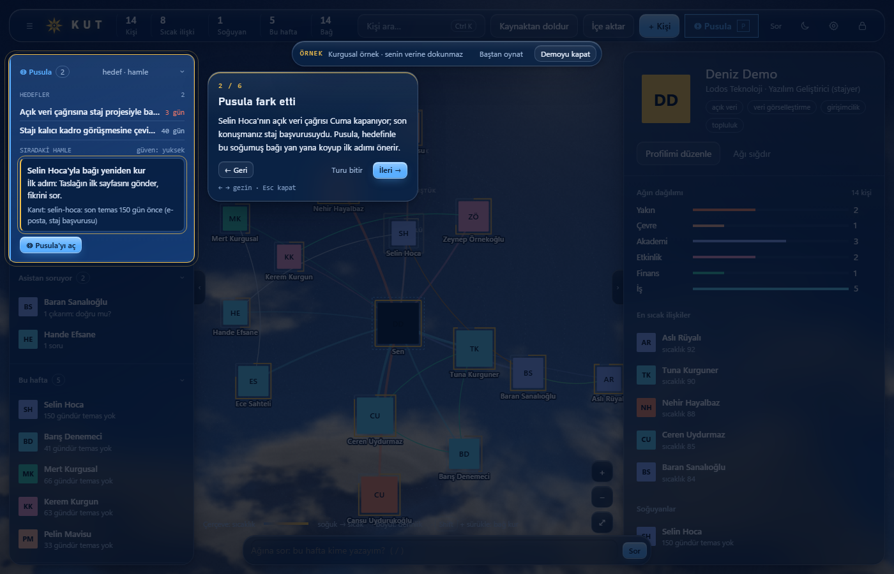 | 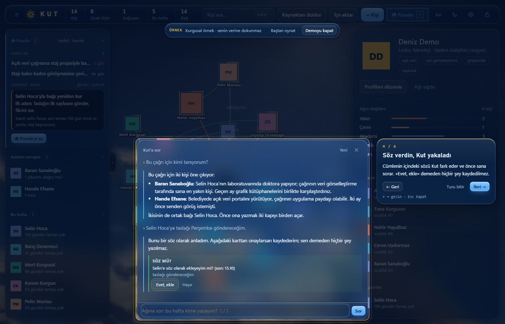 | 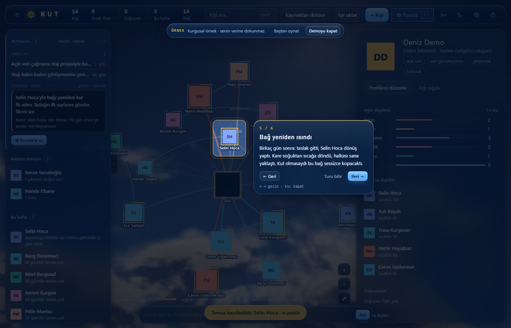 |

Kendi verini girmeden denemek (ya da ekran görüntüsü/video çekmek) için `demo/demo_veri.py` 31 kurgusal kişi (ikisi dolaylı), ilişkiler, bekleyen çıkarımlar,
iki hedef ve örnek bir strateji okuması üretir. Tüm adlar ve kurumlar uydurmadır; kişilerin fotoğrafı yoktur; harita onları tür renginde dolu kare ve baş harf olarak çizer.
Tarihler bugüne göre göreli üretilir, böylece "Bu hafta" listesi her zaman dolu gelir. İçe aktarmayı denemek için `demo/ornek/takvim.ics` ve `demo/ornek/linkedin-Connections.csv` kurgusal dosyalarını *İçe aktar* penceresine bırakabilirsin (adlar bu demo verisiyle eşleşir; tarihleri sabittir; önizleme hiçbir şey yazmaz, yazma yalnız *Onayla ve yaz* ile olur).

```powershell
py -3 demo/demo_veri.py --hedef "$env:TEMP\kut-demo"        # --hedef verilmezse geçici klasör açılır ve yolu yazdırılır
py -3 kut.pyw --veri "$env:TEMP\kut-demo" --port 47400
```

Kendi kurulumunu etkilememesi için demoyu ayrı bir ayar klasörüyle çalıştırabilirsin (PIN ve ayarlar `%LOCALAPPDATA%\agim`, macOS/Linux `~/.agim` altındadır):

```powershell
$env:LOCALAPPDATA = "$env:TEMP\kut-demo-ayar"
py -3 kut.pyw --veri "$env:TEMP\kut-demo" --port 47400
```

Demoda çevrimdışı kalmak ve model çağrısını kapatmak istersen, `kut-demo-ayar\agim\ayarlar.json` içine
`{"otomatik_strateji": false, "otomatik_analiz": false, "kesif": {"etkinlik_kaynaklari": [], "vekilpedia": false}}` yaz
(böylece Pusula keşfi hiçbir siteye gitmez ve model çağrısı yapılmaz). İlk açılışta kendi PIN'ini belirlersin.

## Kullanım ayrıntıları

- **+ Kişi ekle / Düzenle:** fotoğraf, isim, tür, yakınlık (0 tanımıyor · 1 yazıştık · 2 görüştük · 3 güçlü), kurum, iletişim,
  sonraki adım + tarihi, "neden önemli", "ne verebilirim".
- **Temas ekle:** kişiyle her konuşmadan sonra tek cümle; son temas ve "Bu hafta" listesi buna göre güncellenir.
- **Senin beyanın:** düzenle penceresinde "Ne sıklıkla görüşüyorsunuz?" (her gün / haftalık / aylık) ve "Senin görüşün".
  Kayıt tutmasan da puanlar buna göre hesaplanır; asistanın çıkarımları bunu ezmez.
- **Bağ kur:** haritada bir kişiden diğerine **Shift + sürükle** (ya da kartta *Bağ kur* → hedefe tıkla), tipi tek tıkla seç:
  arkadaş, birlikte çalışıyor, mentor, yönetici, iş ortağı, akraba, partner, rakip, gerginlik.
- **Asistan soruyor / Doğrula:** her çıkarım için *Doğru / Düzelt / Yanlış*; soruları da cevapla. Cevapların sonraki analizlere yön verir.
- **Fotoğraf:** yükleyince görünecek kısmı sürükleyip yakınlaştırarak seç; mevcut fotoğrafa tıklayıp yeniden kırpabilirsin.
- **Sol panel:** kenardaki kulp ya da `[` tuşu ile gizle/aç.
- **Özgeçmiş ve belgeler:** kişinin *Özgeçmiş* sekmesine özgeçmiş, profil sayfası, haber, PDF ya da ekran görüntüsü bırak
  (ya da metni yapıştır). Asistan özetler; özet, özgeçmiş maddeleri, kurum/rol ve iletişim *Doğrula*'ya düşer, onaylayınca yazılır.
  Dosya `veri/belgeler/<kişi>/`'de kalır; içerik özet için asistan modeline gider (kapıdan geçerek).
- **Kut'a sor (alt çubuk, `/`):** ağına soru sor ya da bilgi yaz; art arda, birbiriyle ilgisiz kişiler hakkında yazabilirsin. Asistan bunları ayırıp
  ilgili kişilere temas, beyan, görüş, görüşme sıklığı, sonraki adım, iletişim bilgisi ya da bağ olarak kaydeder; yeni kişiyi açar. Senin söylediğin
  beyandır, doğrudan yazılır; ad belirsizse sorar. Asistanın kendi çıkarımları yine Doğrula'ya düşer.
- **Asistanın karakteri:** Profilimi düzenle → "Asistanının karakteri" (boşsa sıcak, doğrudan, meraklı; "sen" diye hitap eder).
- **İçe aktar:** telefonda WhatsApp sohbeti/grubu → *Sohbeti dışa aktar → Medya olmadan* (.txt/.zip), rehber → .vcf.
  Dosyayı sayfaya bırak, gelen adaylardan istediklerini seç. Önce "WhatsApp'taki adın" alanını doldur.
  Pencerenin sekmeleri aşağıdaki dosya türlerini işler. **Hepsi bu bilgisayarda çalışır, ağa çıkmaz, model kullanmaz**; ham dosya diske yazılmaz
  (yalnız WhatsApp'ta "sohbet metnini sakla"yı seçersen); ZIP'ler yol, boyut ve zip bombası denetiminden geçer; yükleme uçları kilit + anahtar + yerel Origin ister.
  Önizleme hiçbir şey yazmaz; *Onayla ve yaz* yazar, ikinci kez yüklemek aynı satırı ikinci kez yazmaz.

  | Kaynak | Dosya | Ne alınır | Ne alınmaz | Sonuç |
  |---|---|---|---|---|
  | WhatsApp | .txt / .zip | ad, mesaj sayısı, tarih, konuşma ölçümleri | mesaj içeriği (saklamayı sen seçmedikçe) | seçtiğin adaylar ağa girer |
  | Rehber | .vcf | ad, telefon, e-posta, kurum, rol, fotoğraf | not alanları | seçtiğin adaylar ağa girer |
  | Takvim | .ics ya da Google Takeout .zip (Google, Outlook, Apple) | katılımcı (e-posta + ad), tarih, `SUMMARY` yalnız "Başlıkları yaz" açıksa kısaltılmış (varsayılan kapalı, "toplantı" yazılır; sağlık/hukuk/maaş gibi başlıklar açıkken de "toplantı" olur) | açıklama, konum, bağlantı, ek, alarm | mevcut kişilere `GG.AA.YYYY · takvim · toplantı` satırı ve yalnız ileri giden `son_temas`; tanınmayan katılımcılar seçersen yeni kişi (yakınlık 0); e-postası boş kişilerin e-posta önerisi Doğrula'ya düşer. Tekrarlayan etkinlikler yalnız geçmişte, seri başına en fazla 60; 15'ten çok katılımcılı toplantılar yakınlık sayılmaz (istersen sayılır); kendi adresin çıkarılır |
  | LinkedIn | veri kopyası .zip, `Connections.csv` (başta "Notes:" olabilir), `messages.csv` | bağlantının adı, URL, e-posta, şirket, pozisyon, bağlanma tarihi; mesajlarda yalnız kiminle ve hangi gün | mesaj içeriği ve konusu hiçbir yerde okunup saklanmaz; ZIP'teki diğer dosyalar açılmaz | mevcut kişide yalnız boş linkedin/kurum/rol Doğrula'ya öneri; bağlanma tarihi `## Kaynaklar` notu; mesaj günleri `linkedin` temas satırı; yeni bağlantılar yalnız seçersen (yakınlık 0, tür tahmini yok); binlerce bağlantıda arama, süzme ve toplu seçim |
  | Ders listesi | yapıştırılan metin | ders kodu, ders adı, hoca adı (Prof. Dr., Doç. Dr., Dr. Öğr. Üyesi, Öğr. Gör., Arş. Gör. gibi unvanlar atılır) | yok | dersler profilene, hocalar ağa (yakınlık 0, tür akademi, `## Dersler`, `hocasi` bağı); okul sitesine istek yok |

  Kendi e-postanı "Takvimdeki e-posta adresin" alanına yazarsan (ya da takvim dosyasında takvim adı e-postaysa) Kut seni katılımcılardan çıkarır ve `ayarlar.json` → `ben_epostalari`'na kaydeder.
  Başlık tercihi `ayarlar.json` → `takvim_baslik` (true/false) olarak hatırlanır.
  İçe aktarma sınırları (v1.1): takvim dosyasında en çok 6 milyon satır ve 200 bin etkinlik işlenir, ayrıştırma + tekrar genişletme en çok 90 sn sürer; tekrarlayan kuralların toplam genişletme bütçesi dosya başına 2 milyon dönemdir (aşılırsa kalan seriler yalnız ilk etkinliğiyle sayılır ve önizleme bunu söyler), `INTERVAL` en çok 10 000'dir, bozuk/taşan tarihli seri tek etkinliğe iner. Takvimden *tahmin edilen* e-posta adresin (takvim adı ya da her toplantıda görünen tek adres) bu içe aktarmada seni katılımcılardan çıkarmak için kullanılır, ama kalıcı olarak (`ben_epostalari`) yalnız önizlemedeki ayrı, varsayılan işaretsiz kutuyu işaretlersen kaydedilir; kendin yazdığın adres onaysız kaydedilir. Önizlemeler genel veri kilidini tutmaz (arayüz takılmaz) ve aynı anda tek yükleme işlenir; ikincisi 429 "Başka bir içe aktarma işleniyor" döner.
- **Hariç listesi:** `veri/haric.md`'ye iletişim kurmak istemediğin kurum/parti adlarını yaz; bunlar hiçbir öneriye girmez ve modele gitmez.
- **Dolaylı kişiler ve odak:** seninle doğrudan bağı olmayan, yalnız başkası üzerinden tanıdığın kişiler (yakınlık 0, temas kaydı yok) haritada
  varsayılan olarak gizlidir. Bir kişiye **çift tıkla**: o kişi merkeze geçer, yalnız onun bağları görünür; **Esc** ya da "← Ağıma dön" geri alır.
  Hepsini görmek için Görünüm → "Dolaylı kişileri de göster".
- **Giriş animasyonu:** pencere ilk açılışta kısa bir giriş oynatır; tık, Esc ya da Enter atlar. Tamamen kapatmak için tarayıcı konsolunda
  `localStorage.setItem("kut-giris", "0")` (animasyonla birlikte açılış sesi de atlanır; sesi tek başına kapatan bir ayar yoktur). Tık ve geçiş sesleri ise Ayarlar → *Arayüz sesleri* ile kapatılır.
- **İkinci beyin köprüsü:** `%LOCALAPPDATA%\agim\ayarlar.json`'a `"vault": {"yol": "C:\\...\\kasa"}` yazarsan sol panelde kasadaki açık işler (`tasks/*.md`) ve
  fikirler (`notes/fikirler.md`), kişi kartında kişinin kasada geçtiği satırlar görünür. Köprü kasaya yazmaz; kişisel notlar, kurallar ve günce okunmaz (`ag_vault.py`, `HARIC`).
  **Kasadan kişileri al:** Ayarlar → Kaynaklar → *Kasadan kişileri al* kasadaki `kind: person` notlarını önizler ("Kasadan N kişi bulundu: X yeni, Y güncelleme"), sen onaylayınca yazar.
  title → ad, aliases, `facts` (kurum, rol, son temas) → alanlar; Beyan → *Senin beyanların*; Temaslar → *Temas*; *Çıkarım (onay bekliyor)* → **Doğrula** kuyruğu (doğrudan yazılmaz);
  Kaynaklar + kaynak notun yolu → *Kaynaklar*. Aynı ad/takma adlı kişiyle birleşir (yalnız boş alanı doldurur, beyanını ezmez), yazımdan önce `arsiv/surum/`'a kopya alınır, tekrar çalıştırmak güvenlidir.
  **Güven etiketi:** `trust: untrusted`, `trust: quarantined`, `trusted: false`, tanınmayan her `trust` değeri ya da `status`/`kind: untrusted` olan notun Beyan satırları (ve `facts.iliski`) *Senin beyanların*'a **girmez**; "Kasa notu güvenilmez işaretli; şunu doğrula: …" olarak Doğrula kuyruğuna düşer; aynı notun `kurum`, `rol` (Doğrula'da kurum/rol önerisi), takma adları, Temaslar satırları ve `son_temas` tarihi de doğrudan yazılmaz, Doğrula önerisi olur ve takma adlar onaysız eşleştirmeyi etkilemez (avenox beyin V3 `_trusted_record` ile aynı anlam; `quarantined` Kut'un ek sıkılığıdır). Etiketi olmayan not avenox'ta olduğu gibi güvenilir sayılır: bunlar kullanıcının kendi V3 kişi notlarıdır; `source` avenox'ta kaynak dosya yoludur, güven etiketi değildir.
  Adında kasa/şifre/kimlik/finans/müşteri/özel/gizli geçen klasörler ve `visibility: private` notlar hiç alınmaz. Kasaya yazılmaz; yer tutucu resim üretilmez, `foto` yalnız notta kasa içindeki gerçek bir resme açık bağlantı varsa kopyalanır.
- **Pusula (P):** hedefler `veri/hedefler/<id>.md`; keşif `ag_kesif.py` (vekil verisi (açıksa) haftada bir, etkinlikler 12 saatte bir; kaynak listesi
  `ayarlar.json` → `kesif.etkinlik_kaynaklari`); strateji `ag_strateji.py` (`veri/strateji/<tarih>.md`, hamleleri *yaptım / işe yaradı* diye işaretlersin,
  sonraki okuma bunu görür). Aktif hedef ve Claude Code varsa haftada bir kendiliğinden çalışır (`"otomatik_strateji": false` ile kapanır).
  **Takvim sekmesi** (`ag_ajanda.py`, `GET /api/ajanda?bas=&bit=`): hamle ve hedef son tarihleri, sözler, kişilerin sonraki adımı ve ihmal eşiği, "katılacağım" dediğin etkinlikler ve geçmiş temaslar ay ızgarasında, hafta görünümünde ya da ajanda listesinde (←/→ ay, T bugün). Yerel ve salt okurdur; model ve ağ yok, hariç listesindeki kişi görünmez. Günü seçince hamlenin ilk adımı, kişinin sonraki adımı ya da etkinliğin adresi yan panelde açılır.
- **Ses:** Kut'a sor çubuğunda 🎙 (Ctrl+Boşluk) konuşmayı yazıya çevirir, "🔈 Sesli cevap" cevapları okur. Modeller Kut'un Python'unda değil, kurulu oldukları
  ortamlarda çalışır (`ag_ses.py` → `ag_ses_isci.py`). Ortam şu sırayla aranır: (1) `ayarlar.json` → `"ses": {"oku_python": "<ema ortamı>\\Scripts\\python.exe",
  "yaz_python": "<faster-whisper ortamı>\\Scripts\\python.exe", "yaz_model": "large-v3"}` ile verilen açık yol; (2) Kut'un kendi kurduğu ortam
  (`%LOCALAPPDATA%\agim\ses`); (3) geliştirici kasasındaki eski bilinen yollar; (4) paketleri ve model önbelleği hazır bir sistem Python'u.
  Ses kaydı diske yazılmaz; kurulum dışında hiçbir şey internete gitmez.
  - **Kurulum teklifi (`ag_ses_kur.py`):** ortam yoksa 🎙 / 🔈'a ilk dokunuşta *"Sesli iletişim için Whisper ve EMA Lightning indirilsin mi?"* sorulur
    (Evet · Şimdi değil · Bir daha sorma; sonradan Ayarlar → Kaynaklar → *Sesli iletişim* kartından da yapılır). Boyutlar önceden gösterilir:
    EMA paketleri + model ~0,3 GB; Whisper paketleri ~0,1 GB (+ NVIDIA kartı varsa CUDA kitaplıkları ~1,2 GB); Whisper modeli `small` ~0,5 GB,
    `medium` ~1,5 GB, `large-v3` ~2,9 GB. **Varsayılan model:** NVIDIA kartı varsa `large-v3` (Türkçede en doğru, kartta hızlı), yoksa `small`
    (işlemcide `large-v3` konuşmayı gerçek zamandan çok yavaş yazar; `small` hızlı ama daha çok yanlış yazar, `medium` arası). Kurulumda
    sistemdeki Python 3.11–3.13 aranır (`py -3.x`, `python`; EMA 3.11+ ister, sabitlenen paketler 3.13'e kadar sınanmıştır) ve `ses/oku/.venv` ile `ses/yaz/.venv`
    sanal ortamları kurulur; paketler sabit sürümlüdür (`ema-lightning==1.1.2`, `normalizer-tr==0.7.0`, `torch==2.6.0`, `faster-whisper==1.2.1`,
    `ctranslate2==4.8.2`) ve yalnız tekerlekten (`--only-binary`) kurulur, modeller `ses/hf` altına iner. Python bulunamazsa
    [python.org/downloads](https://www.python.org/downloads/) adresi gösterilir; kendi Python'unu kuran sen olursun. İlerleme yüzdesi gösterilir, **iptal** edilebilir
    (iptalde o kurulumda açılan ortam silinir); Kut kurulum sırasında kapanırsa yarım ortam sonraki açılışta temizlenir. Kurulum günlüğü `%LOCALAPPDATA%\agim\ses-kurulum.log`.
    *Kut'un kurduğunu kaldır* düğmesi yalnız `ses/` klasörünü siler. Uçlar: `GET /api/ses/kurulum`, `POST /api/ses/kurulum/baslat|iptal|kaldir|ayar`
    (kilit + anahtar + yerel `Origin`; `baslat` gövdede `{"onay": true}` ister). "Bir daha sorma" `ayarlar.json` → `ses.kurulum_sorusu: "sorma"` yazar.

### Veri dosyaları
Tek doğru kaynak Markdown'dır (`veri/` klasörü; ayrıntı için `AGENTS.md`):

| Dosya | İçerik |
|---|---|
| `ben.md` | merkezdeki kişi (sen): ad, ilgiler, asistan adı, okul |
| `kisiler/<id>.md` | kişi: frontmatter (`ad, tur, kurum, rol, yakinlik, son_temas, sonraki_adim, ...`) + `## Temas` satırları (`- GG.AA.YYYY · kanal · cümle`) |
| `iliskiler.md` | `\| a \| b \| tip \| not \| kaynak \| tarih \|` tablosu |
| `cikarimlar.md` | onay bekleyen asistan çıkarımları ve soruları |
| `hedefler/<id>.md` | Pusula hedefleri |
| `haric.md` | iletişim kurulmayacak kurum/partiler |

### Kendi ajanın
Bu klasör aynı zamanda bir yapay zekâ ajanının çalışma alanıdır (`AGENTS.md` talimatları): Claude gibi bir ajanla klasörü açıp
"Ali'yle kahve içtik, staj konuştuk, 2 hafta sonra yazacağım" dersen temas, yakınlık ve sonraki adım kaydedilir; "Bu hafta kimle ilgileneyim?" diye sorabilirsin.
Ajan çıkarımlarını önerinin ötesinde kişi dosyasına doğrudan yazmaz.

### Yapay zekâ asistanına bağla (MCP)
Kut bir **MCP sunucusu** olarak da çalışır: Claude Desktop, Claude Code ya da MCP destekleyen başka bir asistan ağını **salt okur** araçlarla
kullanır. "Yarın Deniz'le görüşeceğim, en son ne konuşmuştuk?" ya da "Bu hafta kimi ihmal ettim?" diye sorarsın; asistan Kut'a bakıp cevaplar.
Ek paket gerekmez, port açılmaz, Kut'un penceresi açık olmak zorunda değildir.

| Araç | Ne verir |
|---|---|
| `kisi_ara` | ada, kuruma, role ya da etikete göre kişiler (kimlik, yakınlık, son temas) |
| `kisi_karti` | kurum, rol, nereden, görüşün, sonraki adım, açık sözler, son 10 temas |
| `bu_hafta` | tarihi gelen adımlar, ihmal edilenler, gecikmiş/yaklaşan sözler |
| `son_gorusmeler` | son N günün temasları |
| `brifing` | görüşme öncesi tek sayfa |

**Gizlilik.** Asistana giden her şey asistanın modeline (ör. Anthropic) gider; bu yüzden MCP de Kut'un kişi kapısından geçer:
🔒 *yapay zekâya gönderilmez* işaretli ve `haric.md` ile eşleşen kişiler hiç listelenmez, adlarının geçtiği satırlar atılır, sırlar `[gizlendi]` olur.
Telefon ve e-posta hiç verilmez. Sunucu hiçbir şey yazmaz. PIN kilidi Kut'un penceresini korur; MCP'yi eklemek, asistana bu araçlarla
okuma izni vermek demektir. İstemediğinde istemcinin ayarından kaldır.

**Claude Code:**
```
claude mcp add kut -- py -3 "C:\yol\kut\kut.pyw" --mcp --veri "C:\yol\veri"
```
(macOS/Linux: `python3 ~/Kut/kut.pyw --mcp --veri ~/Documents/Kut`.)

**Claude Desktop:** Ayarlar → Geliştirici → *Yapılandırmayı düzenle* (`claude_desktop_config.json`):
```json
{"mcpServers": {"kut": {"command": "py", "args": ["-3", "C:\\yol\\kut\\kut.pyw", "--mcp", "--veri", "C:\\yol\\veri"]}}}
```
Şimdilik kaynaktan (Python ile) kurulumda çalışır; `Kut.exe` pencereli bir uygulama olduğu için stdio sunucusu olamaz.

## Desteklenen okullar

Ayarlar → Kaynaklar → *Okul bağdaştırıcısı* açılır listesi `kut/ag_okullar.py` kayıt defterinden dolar. Kaynakların her biri robots.txt ve erişilebilirlik açısından canlı istekle denendi (Ekim 2026);
giriş isteyen (OBS/öğrenci girişi), robots.txt'in yasakladığı ya da bot korumalı kaynaklar kullanılmaz.

| Okul (anahtar) | Ders → hoca kaynağı | Kadro / profil | Ders kodu örneği |
|---|---|---|---|
| Yeditepe Üniversitesi (`yeditepe`) | yeditepeders.com ders programı (JSON) | fakülte akademik kadro sayfası + profil: unvan, e-posta, fotoğraf, özgeçmiş, ORCID | `ISE 424-1` |
| İstanbul Teknik Üniversitesi (`itu`) | obs.itu.edu.tr/public/DersProgram (herkese açık ders programı; CRN şube sayılır) | yok (yalnız ders ve hoca adı) | `BIL 100E`, `BIL 100E-14304` |

Okuldan bağımsız: *Akademik profiller* kaynağı (kapalı gelir) hocanın adıyla OpenAlex ve ORCID'e bakar; ad + kurum tek bir kayıtla eşleşirse "Hakkında" önerisi, eşleşme belirsizse "emin değilim" sorusu olarak **Doğrula**'ya düşer, kişi dosyasına doğrudan yazılmaz.

Denenip eklenmeyenler: ODTÜ (OIBS `robots.txt`: `Disallow: /`), Boğaziçi (kayıt sistemi `Disallow: /`), Bilkent (STARS yalnız birkaç sabit sayfaya izin veriyor), Sabancı (Banner "Dynamic Schedule" teknik olarak okunuyor ama `robots.txt` `Disallow: /#` = tüm site yasak; saygı gösterildi),
YÖK Akademik (bot koruması), AVESIS (profil sayfaları açık ama aramayı JS/ES vekili yapıyor; ders→hoca eşlemesi yok), OBS/OIBS Bologna sistemleri (çoğu üniversitede; ders kodundan arama yok, program ağacı form gönderimiyle geziliyor).

## Okul bağdaştırıcısı ekleme

**Okulun yok mu? Bağdaştırıcı ekle.** Okul özellikleri `kut/ag_okullar.py` kayıt defteriyle tanımlanır; anahtar, profildeki `okul` alanının sadeleştirilmiş hâlidir (küçük harf, Türkçe karakter ve aksansız).
Her bağdaştırıcı aynı arayüzü sağlar: `anahtar`, `ad`, `kisa`, `alan_adi`, `dersler(kodlar)` → `([{kod, sube, ad, hocalar, saat, bolum}], bulunamayan)` ve `hoca_profili(ad_veya_url)` → unvan/e-posta/fotoğraf/özgeçmiş/ORCID (kaynak sunmuyorsa boş sözlük).

1. Önce kaynağı kontrol et: ders programı girişsiz ve herkese açık mı, `robots.txt` izin veriyor mu (`#` yorum başlatır: `Disallow: /#` tüm siteyi yasaklar), kullanım koşulu engelliyor mu? Canlı bir istekle ayrıştırılabildiğini doğrula.
2. `Baglastirici`'dan türet, `dersler()`'i yaz (ağ için yalnız `al(url)`/`ag_kaynak._istek` kullan: SSRF koruması, zaman aşımı, boyut sınırı, istek hızı sınırı, robots denetimi hazır; sonuçları `onbellekli()` ile sakla).
3. Dosyanın sonunda `kaydet(SinifAdin())` de; açılır liste ve `ag_kaynak.OKULLAR` kendiliğinden güncellenir. `kurum_en`'e okulun İngilizce adını yaz (OpenAlex kurum eşleşmesi için).
4. Kaynaktan küçük bir HTML/JSON örneği al (kişi adlarını uydur), `tests/fixtures/` altına koy ve ayrıştırıcıyı `tests/test_okullar.py` benzeri bir testle sına; testlerde ağ çağrısı olmasın.

`yeditepe` kaydı eski biçimde (`ag_kaynak.OKULLAR` içinde, `ders_json` + Drupal kadro bloğu) durur; JSON ders programı ve Drupal kadro sayfası olan bir okul için aynı alanlarla kayıt eklemek de yeter:

```python
OKULLAR["okulum"] = {
    "ad": "Okulum Üniversitesi", "kisa": "Okulum",
    "ders_json": "https://ornek.edu/data/courses-{donem}.json",   # herkese açık ders programı (JSON)
    "ders_kaynak": "ornek.edu", "donem": "2026G", "donem_adi": "Güz 2026",
    "kadro": {"ABC": ("https://fakulte.ornek.edu", "12")},         # ders kodu öneki → akademik kadro sayfası, bölüm no
    "kadro_adi": {"ABC": "Okulum Örnek Mühendisliği"},
    "kadro_plugin": "...", "eposta_alani": "ornek.edu",
    "profil_ornek": "ornek.edu/akademik-kadro/<n>",
    "etkinlik_url": "https://ornek.edu/etkinlikler",
}
```

İlkeler: yalnız herkese açık, girişsiz sayfalar; giriş isteyen ya da bot korumalı (CAPTCHA, engelleme) siteleri aşmaya çalışma; hoca fotoğrafı yalnız resmi kurum alan adından; kaynaktan gelen bilgi kaynağıyla yazılır, yalnız boş alanları doldurur, senin yazdığını ezmez.
Profilinde `okul` boşsa ya da tanımsızsa bu özellik kapalıdır ve hiçbir okul sitesine istek atılmaz.

## Kaynak ekleme

- **Yeni üniversite:** `ag_okullar.py`'ye bir bağdaştırıcı eklemek yeter ([rehber](#okul-bağdaştırıcısı-ekleme)); *Kaynaklar* sekmesindeki okul listesine kendiliğinden gelir.
- **Yeni etkinlik kaynağı:** `ayarlar.json` → `kesif.etkinlik_kaynaklari` listesine adres eklenir (sayfada schema.org Event varsa kod gerekmez). Etkinlik taraması `kesif.etkinlik` ayarıyla açıksa taranır.
- **Yeni isteğe bağlı kaynak türü:** `ag_kesif.KAYNAK_AYARLARI`'na bir kayıt ve `kesif.<kimlik>` kapısı; kapı kapalıyken ağa çıkılmamalı (örnek: `etkinlik_acik()`).

## Depo düzeni

```
kut.pyw        başlatıcı (kut/ klasörünü yola ekler, sunucuyu açar; `--ozet` zamanlanmış özet görevidir, sunucu açmaz)
kut/           uygulama kodu (ag_*.py), sürüm (surum.py), güncelleme (ag_guncelle.py), veri göçleri (goc.py), arayüz (ag_sablon.html), simge
tests/         birim testleri
demo/          kurgusal demo verisi üreticisi (demo_veri.py) ve içe aktarma örnek dosyaları (ornek/)
docs/          ekran görüntüleri (img/) ve tasarım taslakları (tasarim/)
paketleme/     Kut.exe derleme (kut.spec, paketle.ps1; Kut.exe.sha256 de üretir)
baslatma/      Windows kısayol kurucu (kur.ps1), macOS başlatıcı (Kut.command)
AGENTS.md      ajan talimatları (kurulum + uygulama içi asistan)
```

Kişisel verin (`veri/`, ya da `--veri` ile verdiğin klasör) depoya girmez.

## Testler

```powershell
py -3 -m unittest discover -s tests          # macOS/Linux: python3 -m unittest discover -s tests
```

Testler yalnız standart kütüphaneye dayanır ve gerçek verine dokunmaz (her biri geçici bir veri klasörü kullanır).

## Lisans

[MIT](LICENSE) © koraykutlu
